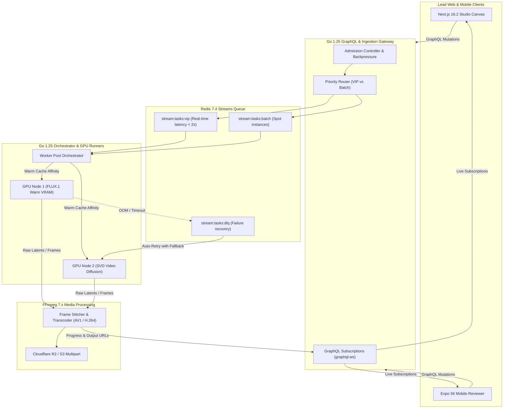

# SPEC-01: StudioForge — High-Scale GenAI Visual Engine & Studio Suite

## 1. Executive Summary & Problem Domain
**StudioForge** is a production-grade GenAI Image & Video Generation Platform engineered to solve the exact problems faced by ImagineArt ($35M+ ARR GenAI scale-up):
- High-throughput asynchronous generation pipelines handling millions of image/video prompts.
- Worker orchestration across pools of GPU runners (ComfyUI / Diffusers / Stable Video Diffusion / FLUX).
- Queue backpressure, priority tiers, retry with exponential backoff, and dead-letter handling.
- Streaming media processing: FFmpeg 7.x frame interpolation, AV1/H.264 video assembly, and WebP generation.
- Lead-level Cross-Platform Clients: Next.js 16.2.6 (Web Studio Canvas) and Expo SDK 56 / React Native 0.85 (Mobile Executive Review) powered by real-time GraphQL Subscriptions.

---

## 2. Global Technology Matrix (2026 Standards)

| Tier | Component | Specification | Rationale |
| :--- | :--- | :--- | :--- |
| **Monorepo** | Workspace Manager | **Turborepo 2.x + pnpm 9.x** | Optimized task caching and shared TypeScript packages. |
| **Web Studio** | Web Framework | **Next.js 16.2.6** (App Router, Turbopack) | React 19.2 Compiler, Three.js 3D canvas, Server Actions v2. |
| **Web Styling** | CSS Engine | **Tailwind CSS v4** + **shadcn/ui** | Next-gen CSS engine with sub-millisecond build performance. |
| **Mobile App** | Mobile Framework | **Expo SDK 56** (React Native 0.85.3) | New Architecture (Bridgeless), Reanimated 4, Expo Video. |
| **API Gateway** | GraphQL Gateway | **Go 1.25+ (`gqlgen`)** | High-concurrency compiled binary, zero-overhead WebSockets. |
| **Client Data Layer**| SDK & Codegen | **Apollo Client 3.12+** + **`@graphql-codegen` v5** | End-to-end type safety, normalized caching. |
| **Pipeline Core** | Worker Orchestrator | **Go 1.25+** (goroutine worker pools) | High-throughput, non-blocking asynchronous pipeline daemon. |
| **Message Broker** | Distributed Queues | **Redis 7.4+ Streams (Valkey) / Kafka** | Priority topics, consumer groups, `XAUTOCLAIM` recovery. |
| **Media Engine** | Frame Transcoding | **FFmpeg 7.x C-Bindings / Pipes** | Zero-copy streaming video encoding, RIFE frame interpolation. |
| **Native Modules** | Mobile Platform Hooks | **Swift (iOS 18)** & **Kotlin (Android 15)** | Native hardware-accelerated video frame caching bridge. |
| **Storage & Caching**| Media Storage | **MinIO / Cloudflare R2 + S3 SDK** | Presigned multipart streaming uploads. |

---

## 3. Monorepo Directory Topology

```text
studioforge/
├── apps/
│   ├── web/                       # Next.js 16.2.6 Studio Web Application
│   │   ├── app/                   # App Router (studio, gallery, pipeline)
│   │   ├── components/canvas/     # Three.js / React Three Fiber generation canvas
│   │   └── package.json
│   └── mobile/                    # Expo SDK 56 / React Native 0.85 Mobile App
│       ├── app/                   # Expo Router 56 tabs (feed, create, monitor)
│       ├── modules/video-cache/   # Swift & Kotlin native frame caching module
│       └── package.json
├── packages/
│   ├── api-graphql/               # GraphQL Schema & Go gqlgen bindings
│   ├── graphql-codegen/           # Typed React hooks for Apollo Client
│   └── ui/                        # Cross-platform theme & component tokens
├── services/
│   ├── pipeline-go/               # Go 1.25 High-Throughput Pipeline Engine
│   │   ├── cmd/server/            # Ingestion & API server
│   │   ├── internal/admission/    # Dynamic backpressure & priority rate limiting
│   │   ├── internal/orchestrator/ # GPU worker pool state machine & ComfyUI bridge
│   │   ├── internal/transcoder/   # FFmpeg 7.x video stitcher & WebP converter
│   │   └── internal/queue/        # Redis Streams consumer group logic
│   └── mock-gpu-worker/           # Simulated GPU cluster node for local testing
├── docs/
│   ├── adr/                       # Architecture Decision Records
│   └── specs/                     # Spec-Driven Development documentation
├── turbo.json
└── pnpm-workspace.yaml
```

---

## 4. End-to-End Generation & Pipeline Architecture


