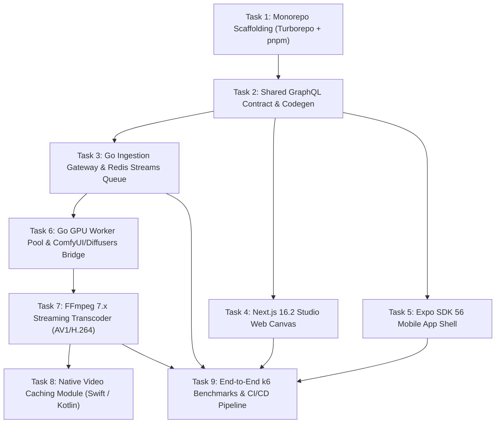

# SPEC-06: StudioForge — Step-by-Step Agentic Implementation Plan & Execution DAG

## 1. SDD Execution Protocol & Grounding Rules
This document governs the mechanical execution of StudioForge by AI agents (Cursor, Claude, Antigravity). Agents must strictly abide by the following constraints:
1. **Contract Invariance:** No modifications to `SPEC-03-GRAPHQL-SCHEMA.graphql` without explicit ADR review.
2. **Atomic Task Execution:** Complete one task at a time. Run verification command before marking a task complete.
3. **Zero-Warning Policy:** Code must compile with zero Go lint issues (`golangci-lint`) and zero TypeScript errors (`tsc --noEmit`).

---

## 2. Dependency Graph (Execution DAG)

---

## 3. Work Breakdown Structure & Verification Gates

### Phase 1: Foundation & Contracts
- [ ] **Task 1.1: Turborepo Monorepo Setup**
  - Initialize `package.json`, `pnpm-workspace.yaml`, and `turbo.json`.
  - Configure `tsconfig.base.json` (strict: true, target: ES2024).
  - *Verification:* `pnpm install && pnpm build` passes with zero errors.
- [ ] **Task 1.2: GraphQL CodeGen Pipeline**
  - Mount `SPEC-03-GRAPHQL-SCHEMA.graphql` into `packages/api-graphql`.
  - Configure `@graphql-codegen/cli` with React 19 / Apollo hooks plugin.
  - *Verification:* `pnpm --filter @studioforge/graphql-codegen run generate` produces valid TypeScript types.

### Phase 2: High-Throughput Go Pipeline (ImagineArt Core)
- [ ] **Task 2.1: Go Ingestion Server & Redis Streams**
  - Implement Fiber v3 / Gin HTTP server with `/graphql` endpoint.
  - Setup Redis Streams producer with partitioned keys (`stream:vip`, `stream:batch`).
  - *Verification:* `go test ./services/pipeline-go/internal/queue/... -v`
- [ ] **Task 2.2: Admission Controller & Backpressure**
  - Implement token-bucket rate limiter and dynamic sampling step degrader (30 steps → 22 steps).
  - *Verification:* Load test script injecting 2,000 req/sec triggers automatic step downscaling.
- [ ] **Task 2.3: GPU Worker State Machine & ComfyUI Mock**
  - Implement worker state transitions: `IDLE` → `RESERVED` → `INFERRING` → `TRANSCODING`.
  - Add warm-cache affinity router checking `ActiveModelID`.
  - *Verification:* `go test -race ./services/pipeline-go/internal/orchestrator/...`
- [ ] **Task 2.4: FFmpeg 7.x Streaming Video Assembler**
  - Build `transcoder.StreamVideoAssembly` piping raw tensor frames directly into `ffmpeg` stdin and outputting AV1/MP4 to Cloudflare R2 / S3 without disk writes.
  - *Verification:* Pipe 120 dummy RGB24 frames through worker; verify valid playable MP4 generated.

### Phase 3: Web Studio & Mobile Client
- [ ] **Task 3.1: Next.js 16.2 App Router Shell**
  - Setup Next.js 16.2.6 with React 19.2 Compiler, Tailwind CSS v4, and shadcn/ui.
  - Connect Apollo Client with WebSocket link pointing to Go GraphQL server.
  - *Verification:* Web app renders generation dashboard at `localhost:3000`.
- [ ] **Task 3.2: 3D Studio Canvas & Realtime Denoising Preview**
  - Integrate Three.js / React Three Fiber canvas for camera positioning.
  - Hook `useSubscription(GENERATION_PROGRESS)` to update canvas frame-by-frame.
  - *Verification:* Mock progressive denoising updates smoothly at 60fps.
- [ ] **Task 3.3: Expo SDK 56 Mobile Client**
  - Setup Expo Router 56 tabs (Studio, Queue, Gallery).
  - Add Shopify FlashList for infinite generation history.
  - *Verification:* `npx expo start` boots mobile web/native bundler cleanly.
- [ ] **Task 3.4: Native Swift & Kotlin Video Cache Engine**
  - Create custom Expo module `modules/native-media-cache`.
  - Implement Swift `AVAssetResourceLoaderDelegate` and Kotlin `SimpleCache`.
  - *Verification:* Preload 5 video URLs; verify subsequent playback reads from disk cache without network requests.

### Phase 4: Verification, Benchmarks & Hardening
- [ ] **Task 4.1: k6 5,000 req/sec Benchmark**
  - Run `k6 run tests/load/k6-gen-stress.js`.
  - *Verification:* Output confirms p99 < 20ms and failure rate < 0.05%.
- [ ] **Task 4.2: CI/CD Pipeline & Architecture Governance**
  - GitHub Actions running lint, typecheck, unit tests, and security audits on PR.
